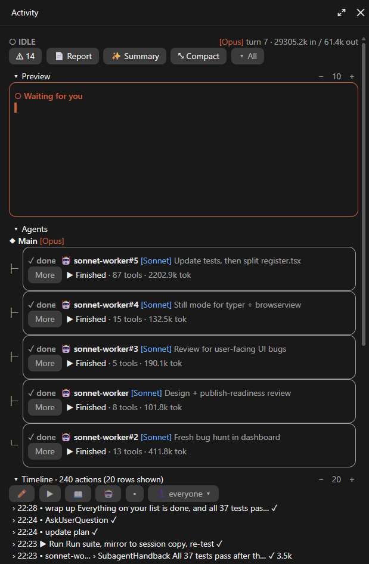
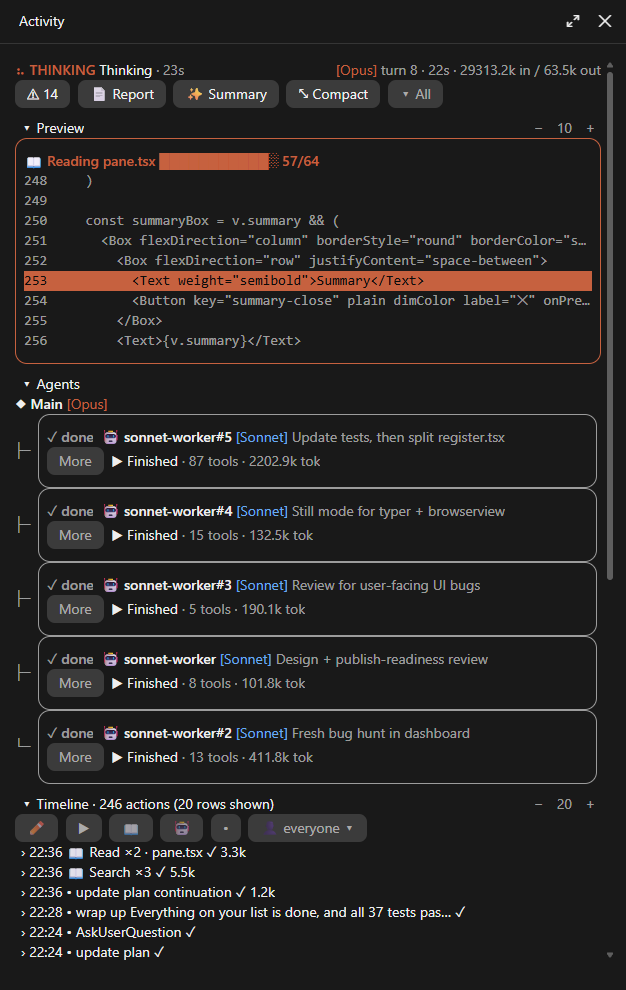

# Activity Dashboard for Claude Code

A live side pane that shows what Claude is doing while it works: what it reads, writes, edits and runs, which subagents are busy, and what each action cost.

<p>
  
  
</p>

## What you get

- **Preview**: a live window onto the current action. Text types in as Claude writes it, edits backspace the old text before typing the new, files are skimmed past a scan bar, commands run in a mini terminal, searches sweep for hits and web results drop in.
- **Agents**: every subagent in a tree under the main loop, each with its own small preview, status, tool count and tokens, and a **Stop** button.
- **Timeline**: one line per action, newest first. Repeats fold into one row (`Read ×5 · a.lua, b.lua`). Click a row to see its diff, command or output. Filter by kind, by agent or by file; the header totals the tokens of what you filtered.
- **⚠ counter**: failed, blocked and risky actions (deletes, force pushes, sends, publishes) in one place.
- **Open files** and **Browser**: the files touched, and roughly where browser clicks landed.
- **📄 Report**: the whole session as an HTML page in your browser, with earlier sessions kept as history.
- **✨ Summary**: a short plain-language summary of the session, on request.
- **⤡ Compact**, collapsible and resizable sections; your layout is remembered.

## Install

From a terminal session of Claude Code:

```
/plugin install activity-dashboard --marketplace NeBlossFeld/claude-activity-dashboard
```

or from a shell:

```bash
claude plugin install activity-dashboard --marketplace NeBlossFeld/claude-activity-dashboard
```

In the desktop app: click **+** next to the prompt box, then **Plugins**, **Add marketplace** with `NeBlossFeld/claude-activity-dashboard`, then add **activity-dashboard**.

The pane opens by itself in the next session.

## Commands

| Command | What it does |
| --- | --- |
| `/activity` | Opens the Activity pane |
| `/activity-open` | Saves the HTML report and opens it in your browser |

## Settings

Press **⚙** in the pane's top bar, or use `/config` in a terminal session.

| Setting | Default | |
| --- | --- | --- |
| Open automatically | on | Open the pane when a session starts |
| Animations | on | Off draws everything still (no spinners, no typing effect) |
| Sessions kept | 10 | How many past sessions the HTML report keeps (1-50) |
| Report folder | `~/.claude/activity-reports` | Where HTML reports are saved |

## Privacy

Everything stays on your computer, with one exception you control:

- **✨ Summary** sends the session's action list (tool names and short summaries, not file contents) to Claude Haiku through your own Claude Code session, and only when you press the button.
- HTML reports are written to the report folder above, never into your project.
- The plugin keeps the last sessions' action lists in Claude Code's plugin storage on your machine for the report's history.

## Development

The plugin is a Claude Code hooks module: `hooks/register.tsx` wires the events, `hooks/pane.tsx` draws the pane, `hooks/state.ts`, `describe.ts` and `report.ts` hold the state, the action descriptions and the report, and `hooks/typer.tsx`, `pulse.tsx` and `browserview.tsx` are the animated client modules.

```bash
claude plugin validate .
claude plugin test .
```

Type definitions (`.claude-plugin/types/`) are written by Claude Code when it loads the plugin from a working folder; `tsconfig.json` extends them.

## License

[MIT](LICENSE) © 2026 NeBlossFeld
